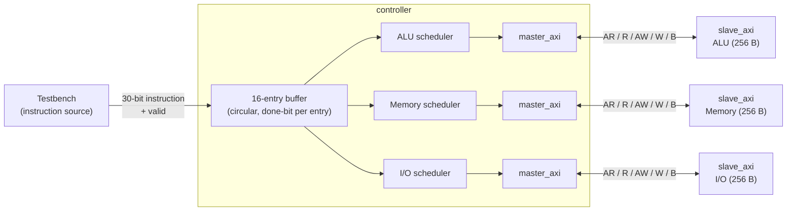
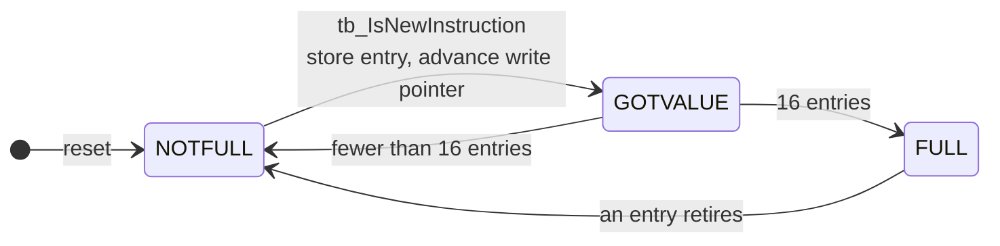
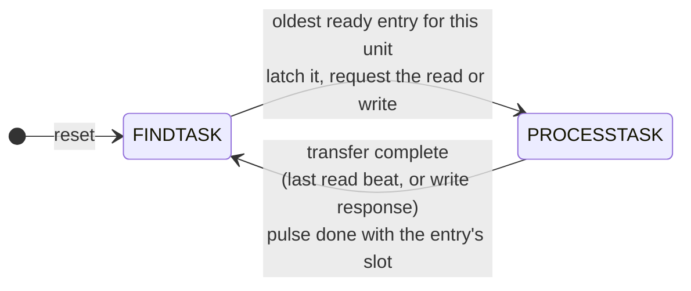
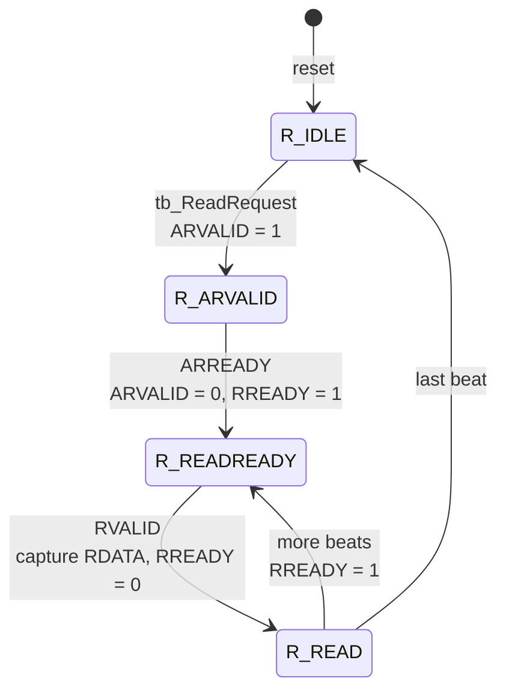
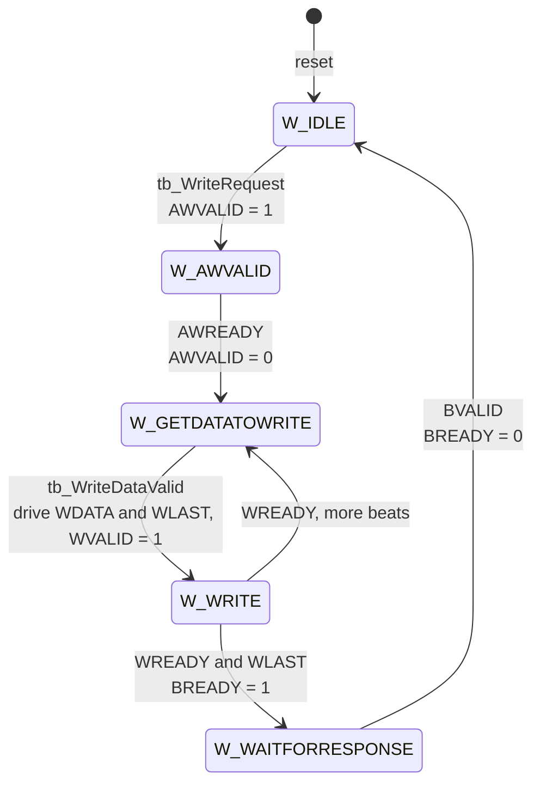
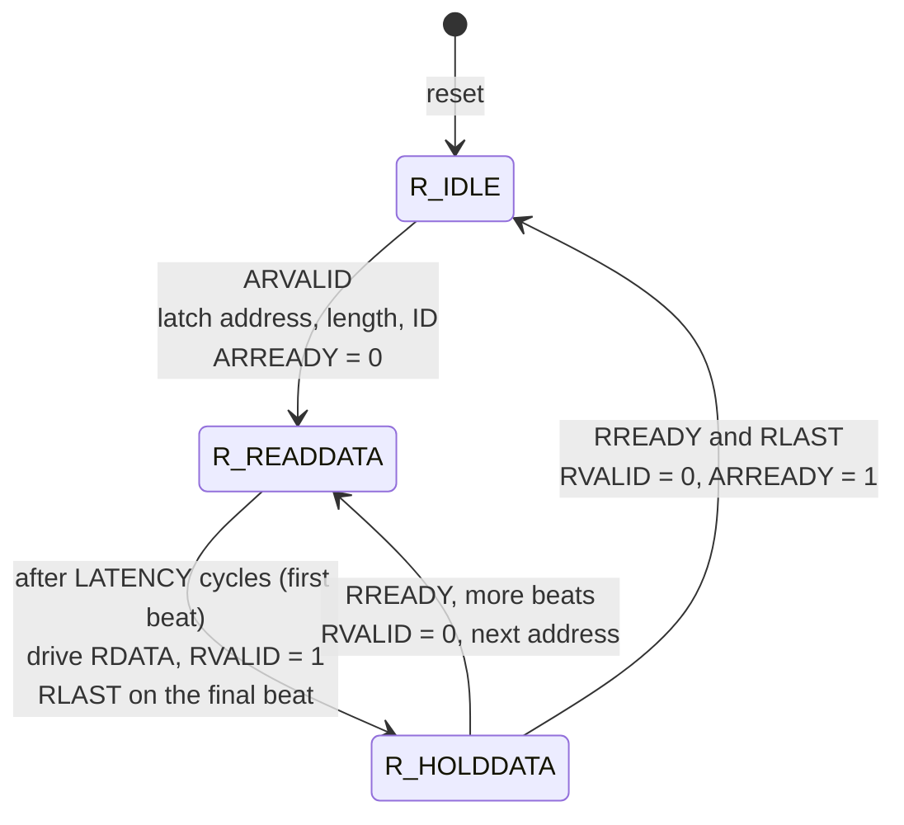
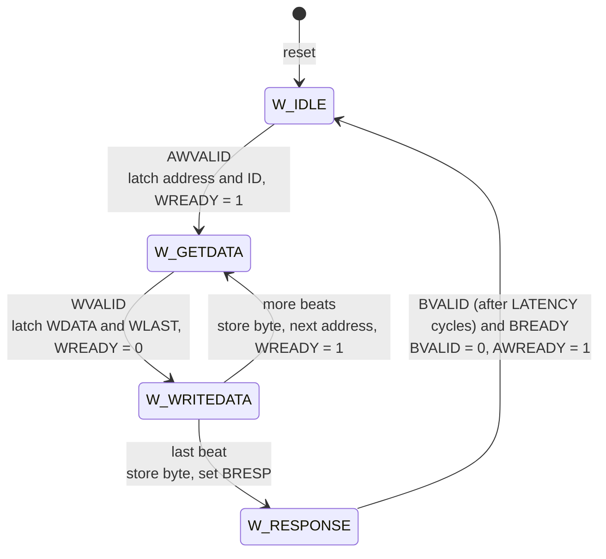

# AXI-Style SoC Controller with Dependency-Aware Scheduling

[](https://github.com/piluiz/axi-soc-controller/actions/workflows/simulate.yml)
[](https://github.com/piluiz/axi-soc-controller/actions/workflows/synth.yml)

A Verilog SoC controller that accepts instructions into a 16-entry queue and dispatches them to three
subordinate units (ALU, Memory, and I/O), each over its own AXI-style master/slave link.
Instructions bound for different units run **out of order and in parallel**, while instructions that
share a **transaction ID** are always executed in the order they arrived.

Built for USC EE 454 (Introduction to System-on-Chip).

## Architecture



### Instruction format (30 bits)

| Bits      | Field          | Meaning                              |
|-----------|----------------|--------------------------------------|
| `[29:22]` | Value          | Data to write (ignored for reads)    |
| `[21:14]` | Address        | 8-bit target address                 |
| `[13:12]` | Unit           | `0` = ALU, `1` = Memory, `2` = I/O   |
| `[11]`    | Op             | `0` = read, `1` = write              |
| `[10:1]`  | Transaction ID | 10-bit ID used for ordering          |
| `[0]`     | Done           | Set by the controller when complete  |

### Scheduling rules

Each unit has its own scheduler (a `FINDTASK` / `PROCESSTASK` state machine). Whenever a unit is
free, its scheduler scans the buffer from oldest to newest and issues the **first instruction for
that unit** that is not blocked. An instruction is blocked if any **older, unfinished** instruction
in the buffer has the same transaction ID, even one destined for a different unit.

The result:

- Independent work on different units overlaps, so a slow I/O write doesn't stall the ALU.
- Same-ID instructions keep program order across all units.
- Finished entries are marked done in place, and the read pointer advances past the finished
  entries at the head of the queue, so slots are reclaimed in order.

A task is complete when its AXI transfer finishes: the last read beat (`RVALID && RREADY && RLAST`)
or the write response (`BVALID && BREADY`). Unit latency is modeled in the slaves, whose `LATENCY`
parameter delays each response (4, 14, and 24 extra cycles for the ALU, Memory, and I/O in the
testbench), so slower units hold their tasks longer.

### Hardware structure

The controller is written to synthesize, not just simulate:

- **One writer for the buffer.** Only the queue logic writes the instruction buffer. A scheduler
  reports a finished task with a one-cycle `done` pulse and the entry's slot number.
- **Shared, fixed-size ready check.** For each of the 16 queue positions, `ready` is "holds an
  unfinished instruction, and no older unfinished instruction has the same ID". That is a fixed
  16 x 16 grid of 10-bit ID comparators, computed once and shared by all three schedulers, since the
  blocking rule doesn't depend on the unit.
- **Priority encoder per unit.** Each `unit_scheduler` picks the oldest ready position whose unit
  code matches its own. The module is instantiated three times with different `UNIT` and
  `LATENCY` parameters.

### AXI-style interface

`master_axi` and `slave_axi` implement the five AXI channels (read address, read data, write
address, write data, write response) with `VALID`/`READY` handshakes, plus:

- **Transaction IDs** carried with every address.
- **Burst reads:** the read address carries a 4-bit length (`ARADDR = {addr[7:0], len[3:0], id[9:0]}`).
- **Burst writes:** data beats continue until `WLAST`.
- **Overflow handling:** bursts that run past address `0xFF` are not wrapped. Writes beyond the end
  are dropped and reported in the write response (`BRESP[9:8] = 2'b10` for WARN, with the count of
  dropped beats in `BRESP[7:0]`).

The signal packing and response encoding are custom, so this is AXI-*inspired*, not a
spec-compliant AXI4 or AXI4-Lite interface.

## Files

| File           | Description                                              |
|----------------|----------------------------------------------------------|
| `Controller.v` | `controller`: instruction buffer, shared ready check, three `unit_scheduler` instances |
| `Scheduler.v`  | `unit_scheduler`: picks the oldest ready task for one unit and drives its `master_axi` |
| `Master.v`     | `master_axi`: read and write state machines              |
| `Slave.v`      | `slave_axi`: 256 x 8-bit memory with burst and overflow handling |
| `tests/Testbench.v` | `controller_tb_v`: directed tests with fixed expected values |
| `tests/Stress_tb.v` | `controller_stress_tb`: randomized stress test that checks the scheduling rules |

## Running the simulation

With [Icarus Verilog](https://steveicarus.github.io/iverilog/):

```sh
# Directed tests
iverilog -o sim Controller.v Scheduler.v Master.v Slave.v tests/Testbench.v
vvp sim

# Stress test (optional: +seed=<n> +n=<instructions> +ids=<1-16>,
# and -P controller_stress_tb.ALU_LAT=<cycles> to change unit latencies)
iverilog -o stress Controller.v Scheduler.v Master.v Slave.v tests/Stress_tb.v
vvp stress +seed=1
```

The design was originally developed and simulated in ModelSim. It also runs in the browser on
[EDA Playground](https://www.edaplayground.com/).

Every push runs both testbenches on GitHub Actions
([`.github/workflows/simulate.yml`](.github/workflows/simulate.yml)): the directed tests, plus the
stress test under three unit-latency configurations. The build fails on any failed check, and the
logs are saved with each run.

## Tests

### Stress test

`tests/Stress_tb.v` sends about 4,200 instructions per run and checks the scheduling **rules** on
every task, not a fixed expected log. A monitor watches each scheduler and fails the run if:

- **Ordering:** a task starts while an older instruction with the same ID is unfinished
- **Priority:** a unit skips an older instruction that was ready for it
- **Data:** a read returns the wrong value, or a write's response isn't OK
- **Bookkeeping:** a task runs on the wrong unit, starts twice, or completes without starting
- **Progress:** no task completes for 5,000 cycles (deadlock), or the queue doesn't empty at the end

The traffic includes a single unit, a single shared ID, a full queue behind a blocked head, all three
units in parallel, and thousands of random instructions over a small set of IDs. IDs differ in their
high bits as well as their low ones, so a comparison that drops bits would be caught. Every address
belongs to one ID, so all accesses to an address are ordered, and a simple reference model predicts
every read even though execution is out of order.

A typical run (unit latencies 4/14/24 cycles, seed 1):

| Measure | Value |
|---|---|
| Instructions sent / completed | 4,240 / 4,240 |
| Tasks started ahead of an older instruction | 2,258 |
| Cycles with 2+ units completing at once | 91 |
| Cycles with the queue full | 23,745 |
| Queue wraparounds | ~265 |
| Errors | 0 |

**Does it catch real bugs?** Each of these bugs was planted in a copy of the design, and the stress
test failed on every one:

| Planted bug | Caught by |
|---|---|
| Ignore transaction IDs (no dependency check) | Ordering |
| Pick the youngest ready task instead of the oldest | Priority |
| Compare only 8 of the 10 ID bits | Priority |
| Compare by buffer slot instead of age (breaks after the queue wraps) | Priority |
| One unit never reports its tasks done | Started twice |
| Finish a read before its data arrives | Data |
| Retire the head of the queue without checking it's done | Priority |

### Directed tests

`tests/Testbench.v` runs these scenarios and prints `[OK]` or `[ERROR]` for each of its 180 checks:

1. Writes then reads on each unit (ALU, Memory, I/O) with a lightly loaded queue
2. Interleaved writes and reads that fill the 16-entry queue (back-pressure)
3. A **dependency test** that mixes transaction IDs across units and logs when each task starts and
   finishes

Dependency-test log from CI (instructions are sent in the order: ALU read ID 3, Memory write ID 4,
I/O write ID 4, Memory read ID 4, ALU write ID 3, Memory read ID 3, Memory read ID 5, ALU write ID 4):

```
ALU Task Started:     R/W: 0, ID: 3
Memory Task Started:  R/W: 1, ID: 4
ALU Task Complete:    R/W: 0, ID: 3
ALU Task Started:     R/W: 1, ID: 3     <- waits for ALU read ID 3
ALU Task Complete:    R/W: 1, ID: 3
Memory Task Complete: R/W: 1, ID: 4
IO Task Started:      R/W: 1, ID: 4     <- waits for Memory write ID 4
Memory Task Started:  R/W: 0, ID: 3     <- waits for ALU write ID 3
Memory Task Complete: R/W: 0, ID: 3
Memory Task Started:  R/W: 0, ID: 5     <- independent ID passes the blocked ID 4 read
IO Task Complete:     R/W: 1, ID: 4
Memory Task Complete: R/W: 0, ID: 5
Memory Task Started:  R/W: 0, ID: 4     <- waits for I/O write ID 4
Memory Task Complete: R/W: 0, ID: 4
ALU Task Started:     R/W: 1, ID: 4     <- waits for Memory read ID 4
ALU Task Complete:    R/W: 1, ID: 4
```

## State machines

All state machines are one-hot. Labels show the condition for a transition and, below it, the
outputs that change.

### Controller

**Instruction queue** (`controller`): accepts one instruction at a time from the testbench and
reports when it is full.



**Unit scheduler** (`unit_scheduler`, one per unit): issues the oldest ready instruction for its
unit and waits for the AXI transfer to finish.



### AXI master (`master_axi`)

**Read**



**Write**



### AXI slave (`slave_axi`)

`LATENCY` is the slave's response-delay parameter. Write beats past address `0xFF` are dropped
and counted in `BRESP`.

**Read**



**Write**



## Limitations and future work

- **Slave memory as registers:** `slave_axi` clears its 256-byte memory on reset, so synthesis builds
  it from flip-flops instead of a RAM block. Initializing it at power-up instead would allow a RAM.
- **Single-beat dispatch:** the controller issues single-beat reads and writes. Bursts are
  supported by the master and slave but not exposed through the instruction format.
