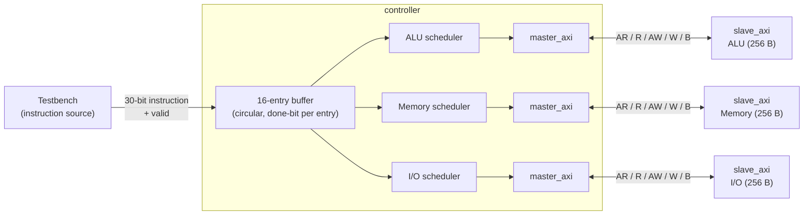
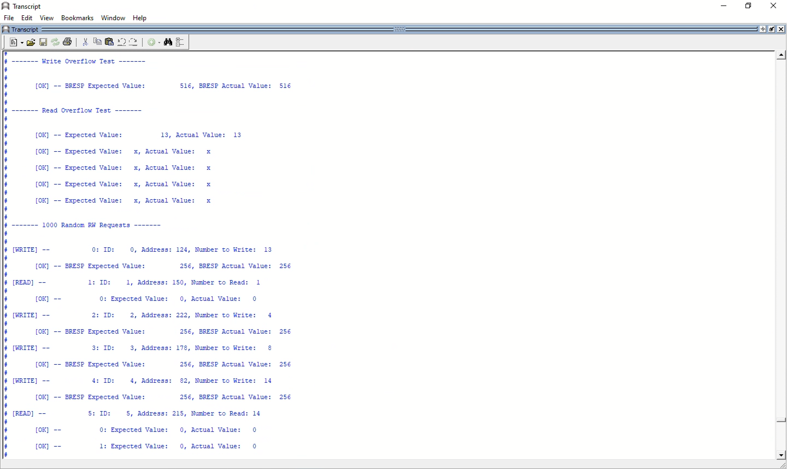
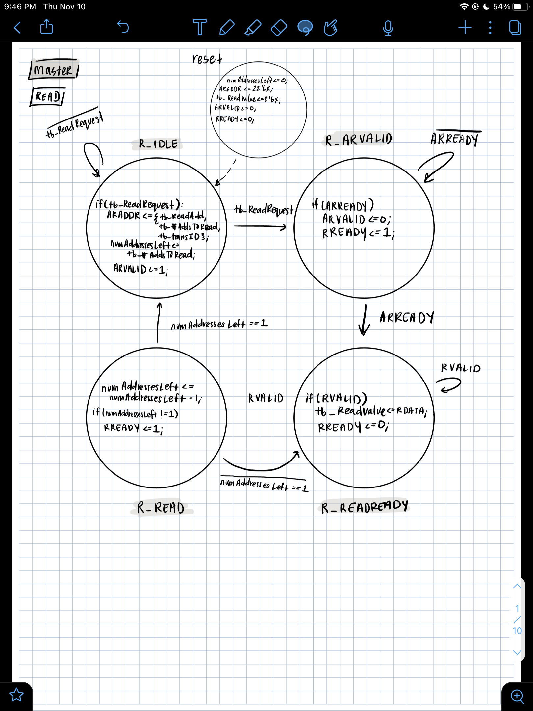
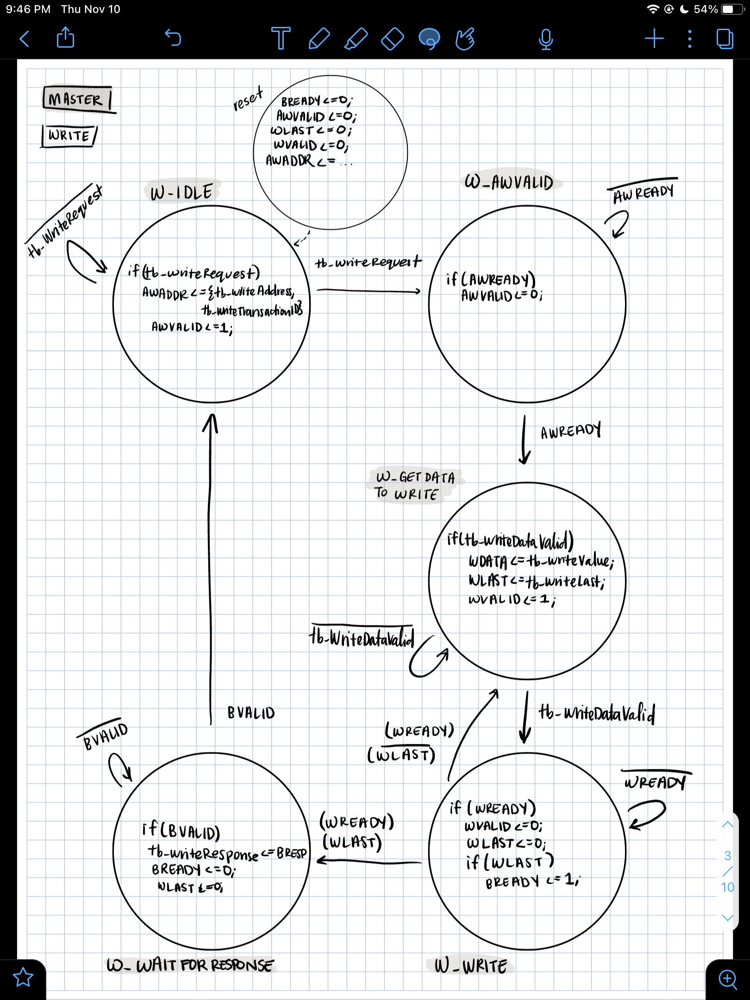
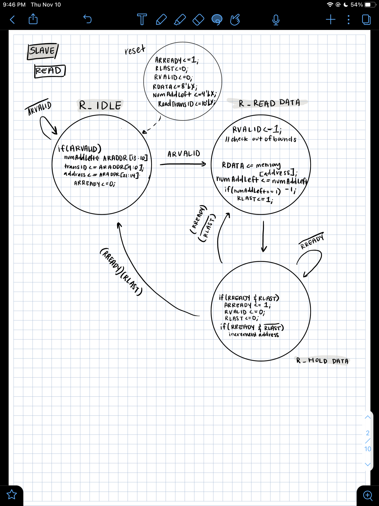
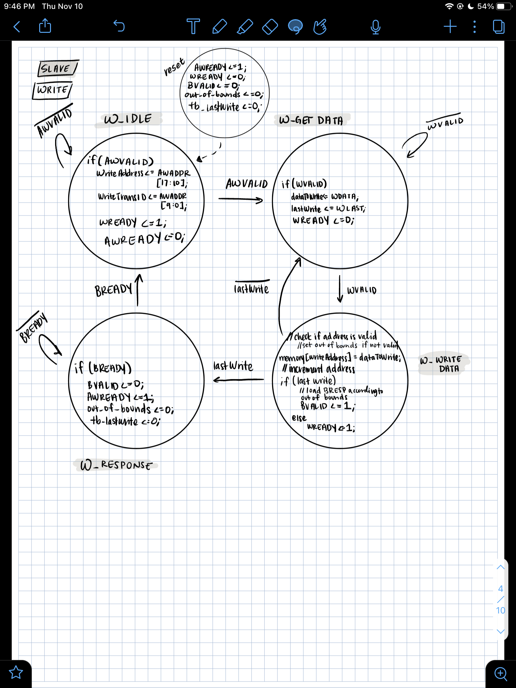

# AXI-Style SoC Controller with Dependency-Aware Scheduling

A Verilog SoC controller that accepts instructions into a 16-entry queue and dispatches them to three
subordinate units (ALU, Memory, and I/O), each over its own AXI-style master/slave link.
Instructions bound for different units run **out of order and in parallel**, while instructions that
share a **transaction ID** are always executed in the order they arrived.

Built for USC EE 454 (Introduction to System-on-Chip).

## Architecture



### Instruction format (30 bits)

| Bits      | Field          | Meaning                              |
|-----------|----------------|--------------------------------------|
| `[29:22]` | Value          | Data to write (ignored for reads)    |
| `[21:14]` | Address        | 8-bit target address                 |
| `[13:12]` | Unit           | `0` = ALU, `1` = Memory, `2` = I/O   |
| `[11]`    | Op             | `0` = read, `1` = write              |
| `[10:1]`  | Transaction ID | 10-bit ID used for ordering          |
| `[0]`     | Done           | Set by the controller when complete  |

### Scheduling rules

Each unit has its own scheduler (a `FINDTASK` / `PROCESSTASK` state machine). Whenever a unit is
free, its scheduler scans the buffer from oldest to newest and issues the **first instruction for
that unit** that is not blocked. An instruction is blocked if any **older, unfinished** instruction
in the buffer has the same transaction ID, even one destined for a different unit.

The result:

- Independent work on different units overlaps, so a slow I/O write doesn't stall the ALU.
- Same-ID instructions keep program order across all units.
- Finished entries are marked done in place, and the read pointer advances past the finished
  entries at the head of the queue, so slots are reclaimed in order.

The units model different latencies with a counter: about 9 cycles for the ALU, 19 for Memory, and 29 for I/O.

### AXI-style interface

`master_axi` and `slave_axi` implement the five AXI channels (read address, read data, write
address, write data, write response) with `VALID`/`READY` handshakes, plus:

- **Transaction IDs** carried with every address.
- **Burst reads:** the read address carries a 4-bit length (`ARADDR = {addr[7:0], len[3:0], id[9:0]}`).
- **Burst writes:** data beats continue until `WLAST`.
- **Overflow handling:** bursts that run past address `0xFF` are not wrapped. Writes beyond the end
  are dropped and reported in the write response (`BRESP[9:8] = 2'b10` for WARN, with the count of
  dropped beats in `BRESP[7:0]`).

The signal packing and response encoding are custom, so this is AXI-*inspired*, not a
spec-compliant AXI4 or AXI4-Lite interface.

## Files

| File           | Description                                              |
|----------------|----------------------------------------------------------|
| `Controller.v` | `controller`: instruction buffer, three schedulers, three `master_axi` instances |
| `Master.v`     | `master_axi`: read and write state machines              |
| `Slave.v`      | `slave_axi`: 256 x 8-bit memory with burst and overflow handling |
| `Testbench.v`  | `controller_tb_v`: self-checking testbench with three slaves |
| `docs/`        | State machine diagrams and a simulation transcript       |

## Running the simulation

With [Icarus Verilog](https://steveicarus.github.io/iverilog/):

```sh
iverilog -o sim Controller.v Master.v Slave.v Testbench.v
vvp sim
```

The design was originally developed and simulated in ModelSim. It also runs in the browser on
[EDA Playground](https://www.edaplayground.com/).

## Tests

`Testbench.v` runs these scenarios and prints `[OK]` or `[ERROR]` for each check:

1. Writes then reads on each unit (ALU, Memory, I/O) with a lightly loaded queue
2. Interleaved writes and reads that fill the 16-entry queue (back-pressure)
3. A **dependency test** that mixes transaction IDs across units and logs when each task starts and
   finishes

Expected dependency-test log (tasks that start or finish on the same clock may print in either order):

```
ALU Task Started:    R/W: 0, ID: 3
Memory Task Started: R/W: 1, ID: 4
ALU Task Complete:   R/W: 0, ID: 3
ALU Task Started:    R/W: 1, ID: 3     <- waits for ALU read ID 3
ALU Task Complete:   R/W: 1, ID: 3
Memory Task Complete: R/W: 1, ID: 4
IO Task Started:     R/W: 1, ID: 4     <- waits for Memory write ID 4
Memory Task Started: R/W: 0, ID: 3
Memory Task Complete: R/W: 0, ID: 3
Memory Task Started: R/W: 0, ID: 5     <- independent ID runs ahead
IO Task Complete:    R/W: 1, ID: 4
Memory Task Complete: R/W: 0, ID: 5
Memory Task Started: R/W: 0, ID: 4
ALU Task Started:    R/W: 1, ID: 4
Memory Task Complete: R/W: 0, ID: 4
ALU Task Complete:   R/W: 1, ID: 4
```

### Master/slave results (Phase 1)

Transcript from the standalone master/slave testbench used in the project's first phase (overflow
tests and 1,000 random burst requests):



## State machines

| Master read | Master write |
|---|---|
|  |  |

| Slave read | Slave write |
|---|---|
|  |  |

## Limitations and future work

- **Simulation-oriented:** the instruction buffer is written from several `always` blocks, and the
  schedulers use unbounded `for` loops in clocked logic. Synthesizing it would require a single owner
  for the buffer, with schedulers sending done requests to it.
- **Fixed-latency completion:** a task is marked done after its unit's delay counter expires, not
  when the AXI write response or the last read beat arrives.
- **Single-beat dispatch:** the controller issues single-beat reads and writes. Bursts are
  supported by the master and slave but not exposed through the instruction format.
- **Repeated code:** the three schedulers are nearly identical and could become one parameterized
  module.
